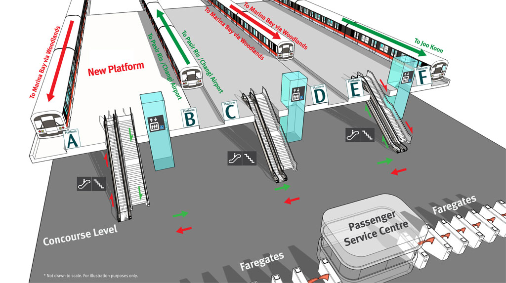
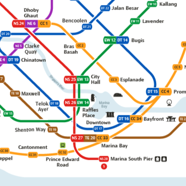

Being a west-sider in Singapore, I have visited Jurong East countless times. I grew up
with Jurong Entertainment Centre, then with JCube, which both have since been demolished
(is the lot cursed?) to make way for the J'den condo (a very cursed name).
I loved visiting IMM, Big Box had a special place in my heart,
and Westgate and JEM are reliable haunts.

As an adult, Jurong East is no less relevant as one train station I must pass by 
on my way to work. The increased frequency of my commuting has 
given me more observations of people coming and going, and I have come to the conclusion that,
by design or by human nature, the way people go about changing trains at this terminal
is suboptimal and, in my experience, has resulted in conflict between people.

I'm writing this to express my thoughts on how the design of the local MRT system 
can be better. I'm currently aware of plans for two new lines, and each time one 
is erected, it feels like a rushed job, not to mention all the environmentalist concerns.

## The Layout

<figure>

<figcaption>

Image provided by SMRT [via Facebook](https://www.facebook.com/share/18XGGMLVFR/).
Platform A was opened in 2011.

</figcaption>
</figure>

Jurong East (JE for short), as a terminal *and* and interchange, connects people 
from the end of the North-South line (NSL) to the middle of the East-West line (EWL),
two of the oldest train lines in Singapore.

The NSL trains come and go via platform D/E.
During peak hours, the NSL trains alternate between platforms A and D/E.
The EWL train at platform B/C is eastbound, and the one at platform F is westbound.

JE quite nicely segments the westernmost part of Singapore, mainly the industrial hub,
from the rest of the EWL, which includes the central business district and airport.

As you can tell, there will be two groups of people commuting at Jurong East in the morning,
both headed to work in different directions.

### The Problem

Most commuters coming from NSL going to the east would have no issue with the station's layout. 
They come in via any of the NSL trains, and can easily get to the eastbound EWL train at platform B/C.

With those heading west, however, there is a complication. The NS train that arrives
in platform A is far from platform F. For them to make the transfer, they would have to 
go down to the concourse level and walk over.

What most of them do is stay at the train platform and walk through 
the trains to cut through to platform F. They'd have to go through the EW train (eastbound)
and then the NS train at platform DE to get to platform F, in that order. 

This, I feel, is suboptimal, which is a point I'll elaborate on, 
but understandably it's a locally optimal solution if one is to minimise stair climbing.

Still, it's disruptive. There was once, when the train was full, someone tried 
to shove through to get to the other side. This resulted in a bit of argument between passengers. 

Another time, a passenger tried to cut through, but the train doors closed before he could 
get to the other platform. I observed him as he waited 'til the EWL (eastbound) train got 
to Clementi before he alighted and waited for the opposite train to reverse direction
(and the JE -> Clementi distance is nothing to scoff at!).

## The "Logical" Answer

> If your solution to some problem relies on "If everyone would just…" then you do not have a solution.
> Everyone is not going to just. At no time in the history of the universe has everyone just,
> and they’re not going to start now.
> <cite>Tumblr User squareallworthy</cite>

Obviously, the intended solution is to go down to the concourse. But this is a very 
*Singaporean* approach to solving problems: it requires co-operation, is inelegant,
and frankly speaking I'm surprised there wasn't a barricade put up to
coerce this behaviour.

Let me digress a little to show you that our infrastructure *can* be improved to accommodate 
the traveler, and their needs usually manifest in the form of [desire paths](https://en.wikipedia.org/wiki/Desire_path).
It wasn't too long ago that [barricades were removed](https://www.straitstimes.com/singapore/transport/section-of-barrier-outside-marina-bay-mrt-station-removed-as-more-workers-return-to-offices-lta)
at Marina Bay MRT. 

The next solution is probably also intended but never done in practice. Simply 
take the NSL train that's bound for platform D/E. On the other NSL stations,
there is an announcement for which platform the next train is bound. Then, simply 
take the train that will arrive at the correct platform. For those heading east,
either platform works, but only platform D/E is directly connected to F.

It's not immediately obvious, but it's better to wait for the correct train 
rather than take the first train you get and try your luck at JE when you 
get there. This is a classic *greedy algorithm*.

The reason why this is so is because the trains alternate platforms. If one 
goes to A, the next one will go to D, and they will always arrive in the same order,
since they're on the same track up until JE.

Since the strategy for reaching platform F requires minimally for there to be 
an NSL train at platform D/E, the logical person will conclude that they should 
just be waiting to arrive in that NSL train. *Furthermore*, there needs to be 
an EWL train at platform B/C before they can cross the platform at D/E.
If that train fails to arrive, then you might miss the chance to cross the NSL 
train at D/E, and have to wait for the *NEXT* one (which, because they alternate,
would be the fourth train).

That means that by arriving at platform A and trying to cross the trains
into platform F, the time you spend is roughly the same at best, and 
even more at worst!

The problem is just simply: this is not obvious! 

If *I* had to commute to the west, I probably would have figured out to do this 
within the first few trips. It's not rocket science. But the average person going 
to the west during peak hours is generally showing up to work, and the 
nature of the work is typically industrial. It's not wrong to assume they're going 
to be a foreign worker, which is common in Singapore. And being foreign,
they probably aren't too used to the transport system.

What can be done aside from tearing down the station and rebuilding it? Well,
the simplest could be an information campaign to let NSL-riders know specifically 
that they should be paying attention to which platform the train will end up in.

That might not work, but it's worth a try. I think the real solution might be
to just strong-arm it. Stop the train doors from opening on both sides. Now,
if you want to access platform F, you MUST come in from platform D/E.

To make it fair, the trains at platform D/E could only open at platform E,
so those going to the east need to take the one at platform A. I don't think
this is necessary, as there's generally more people going east anyway, 
but in any case, you can see that any coercive solution that's for a generally 
beneficial outcome could be seen as unfair to certain parties on the small scale.

### A Parallel: Raffles Place and City Hall

Let me digress again to mention that such problems to optimise interchanges 
can be solved elegantly. A very good example are the two stations Raffles Place 
and City Hall, which are **both** interchanges between the EWL and NSL, and 
are actually adjacent to each other.

Why have two interchanges next to each other? Well, these stations are smack 
in the middle of the central business district, the heart of the city, so there's
a lot of coming and going. Also, by nature of being an interchange but not terminal,
at least four train platforms are required: one for each direction, multiplied
by one for each train line.

For these two stations, they've elected to have different lines on the same floor,
and opposite directions on different floors. I'll illustrate the genius of its 
design with an example.

If I'm coming from Dhoby Ghaut (South-bound) and I want to go to Lavender (East),
I would have to change train lines at one of the two interchanges. 
It makes more sense to change at City Hall, which is nearer to Lavender. 
Otherwise, I would have to pass through City Hall, then change at Raffles Place, 
and still pass by City Hall again as I'm headed east.

Here's the genius bit: The south train arrives at the same platform as the east 
train! So, commuters need only just walk (in practice: *run*) across and 
transfer seamlessly.

Well, what if you're heading west from Dhoby Ghaut? Do you go up/down another floor 
and transit there?

No! You simply continue on the NSL to Raffles Place, where the south train 
is on the same platform as the west EWL train, then cross the platform!

This design works for any direction you're going. Unless you need to reverse direction,
you won't need to go up or down any floors.

Again, this is not obvious. But it's common knowledge to whomever actually 
commutes to these stations regularly. Why? I like to imagine it's not actually 
knowledge that had to be figured out per se, but an effect of elegant design that 
became noticed. Even if you don't notice it, it still has a positive effect on you.

> Good design is obvious, great design is transparent. <cite>Joe Sparano</cite>

How they got it *so* right here the first time, and then never replicated ever 
again, it baffles me. Honestly, I probably have a lot more to say on the matter,
but I'll probably save it for another time. I've spoken enough on this one topic already.

## So what do we do?

I mean, it's obvious that Jurong East faces different problems from Raffles Place 
and City Hall. Many stations have unique problems to manage, and the issue 
is probably deeper than I can understand. For one, JE's platform A was built as
an extension to support the rush hour. Within the constraints of time and budget,
this was probably the best solution they could come up with.

With the construction of the new Jurong Region Line, perhaps these issues can be better 
mitigated. Until then, there's nothing to do but educate our fellow people, and be gracious 
in our interactions. We all have places to be.
